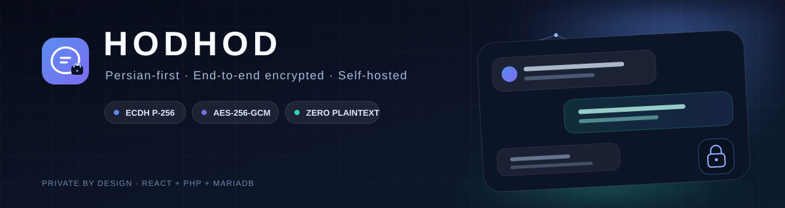
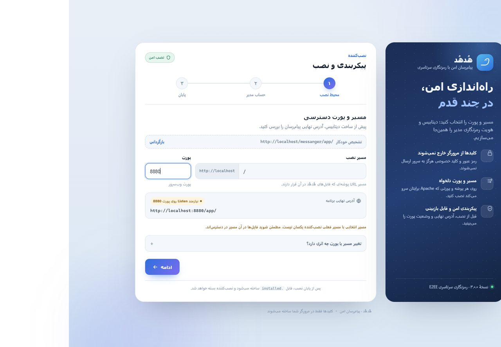
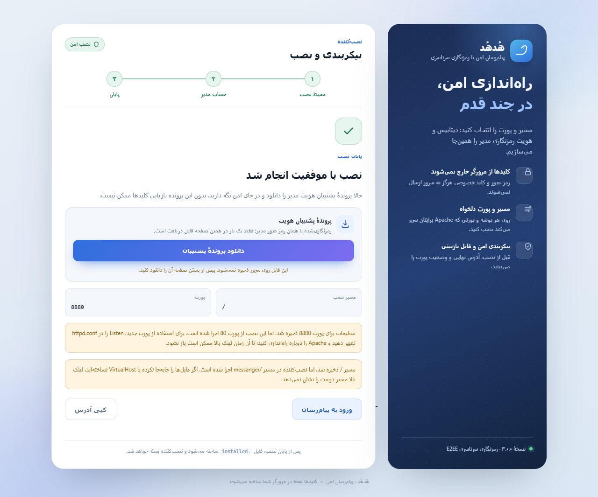
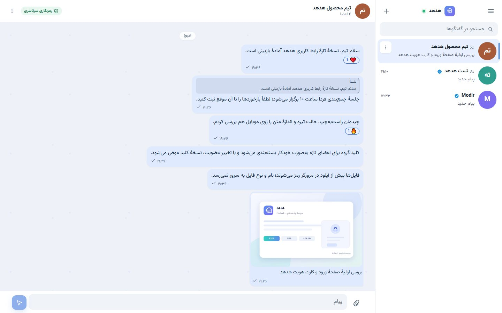
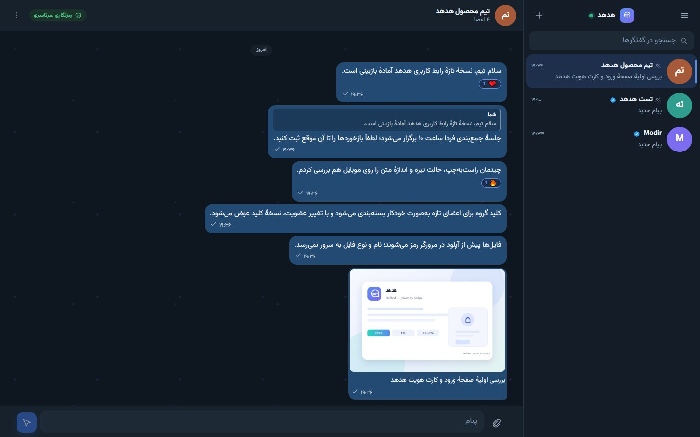

<p align="center">
  <a href="https://nanymous.github.io/hodhod-docs/">
    
  </a>
</p>

<h1 align="center">Hodhod Docs</h1>

<p align="center">
  <strong>Install, operate, and review Hodhod.</strong><br>
  Public operator documentation for a Persian-first, self-hosted messenger with browser-side end-to-end encryption.
</p>

<p align="center">
  <a href="https://nanymous.github.io/hodhod-docs/"><strong>Read the documentation →</strong></a>
</p>

The application source is private. This repository contains the documentation site and its reference notes only.

## What the site covers

| Section | What you will find |
| --- | --- |
| Overview | What Hodhod is, what the server can and cannot see, and who the guide is for. |
| Quick start | Requirements, first-run installer, configurable path and port, and the launcher. |
| Product tour | Real screenshots of onboarding, conversations, groups, settings, admin, and mobile. |
| Architecture | Request lifecycle, project map, storage layout, and the path-neutral base URL. |
| Security model | Key hierarchy, browser-side encryption, metadata exposure, and the threat model. |
| API reference | Authenticated JSON endpoints, pagination, errors, and realtime events. |
| Operations | Backups, key rotation, updates, health checks, and troubleshooting. |
| Testing | The test suites, what they cover, and how to run them. |
| Limitations | Known gaps in security, scaling, deployment, and compliance. |

## Install in one minute

1. Copy the project under your web root and open the installer, for example `http://localhost/messanger/server/install.php`.
2. Choose the final base path and port in the installer. It previews the resulting URL before touching the database.
3. Create the database, administrator account, and backup, then launch with the bundled launcher.

The installer records its choice in `config/install.json`; the app derives its API, asset, E2EE, and SSE URLs from the current location, so no rebuild is required. A root install (`http://localhost:8880/`) still requires the files at the document root, or a VirtualHost `DocumentRoot` that points at the project folder.

<p align="center">
  
  
</p>

> Hodhod encrypts message and file content in the browser. The server still sees metadata, and the project has not undergone an independent security audit. Read [SECURITY.md](SECURITY.md) and [LIMITATIONS.md](LIMITATIONS.md) before using it for high-risk communication.

## Product tour

<p align="center">
  
  
</p>

The full tour covers sign-in, join requests, message actions, media, group details, profile and privacy settings, security devices, appearance, the admin dashboard, English locale, and mobile. Open the [live site](https://nanymous.github.io/hodhod-docs/#tour) to browse every screenshot with captions.

## Reference documents

- [Architecture](ARCHITECTURE.md)
- [Security model](SECURITY.md)
- [Known limitations](LIMITATIONS.md)

## Local preview

The site is static: HTML, CSS, and vanilla JavaScript with no build step and no external dependencies.

```powershell
python -m http.server 8799 --directory docs
```

Open `http://127.0.0.1:8799/`.

## Deployment

Pushes to `main` that touch `docs/**` deploy the `docs/` directory to GitHub Pages through the workflow in `.github/workflows/pages.yml`. The published site is fully static: no analytics, no font CDN, and no telemetry.

- Live site: <https://nanymous.github.io/hodhod-docs/>
- Sitemap: <https://nanymous.github.io/hodhod-docs/sitemap.xml>

Last reviewed: 2026-10-26.
